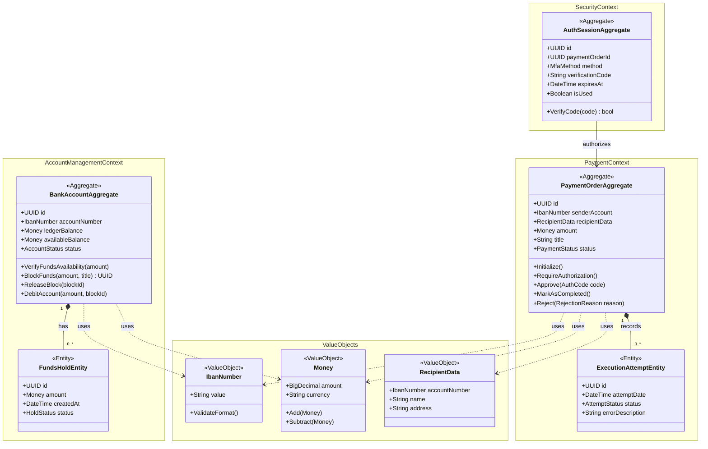

# Model Domenowy Aplikacji Bankowej

**Autor: Paweł Wysocki (325248)**

## 1. Opis Zadania

Opracowany fragment Aplikacji Bankowej został stworzony zgodnie z zasadami Domain-Driven Design. Skupia się on na procesie realizacji płatności - model 
uwzględnia komunikację asynchroniczną między kontekstami zarządzania kontem, uwierzytelniania użytkownika oraz realizacji samych przelewów. 
W ramach zadania zamodelowano logikę biznesową z uwzględnieniem spójności transakcyjnej, reguł autoryzacji operacji i ochrony środków.

## 2. Bounded Contexts

System bankowy podzielono na 6 głównych kontekstów:

1. **Zarządzanie Kontami i Saldami:**
   Odpowiada za cykl życia konta, utrzymanie salda księgowego i dostępnego, naliczanie blokad na środkach oraz egzekwowanie limitów transakcyjnych

2. **Realizacja Płatności i Rozliczeń:**
   Zarządza cyklem życia przelewu (zlecenie, proces autoryzacji, skierowanie do zewnętrznego systemu rozliczeniowego)

3. **Uwierzytelnianie i Autoryzacja:**
   Odpowiada za weryfikację tożsamości użytkownika, zarządzanie sesjami, generowanie wyzwań MFA oraz weryfikację podpisów pod transakcjami krytycznymi

4. **Zarządzanie Klientem:**
   Utrzymuje dane osobowe, adresowe, status weryfikacji tożsamości (Know Your Customer) oraz dokumenty tożsamości

5. **Wykrywanie Nadużyć:**
   Analizuje transakcje w czasie rzeczywistym pod kątem podejrzanych wzorców, limity prędkości transakcji i czarne listy

6. **Zarządzanie Kartami Płatniczymi:**
   Zarządza kartami fizycznymi/wirtualnymi, limitami kartowymi, kodami PIN i autoryzacjami blokad kartowych

## 3. Model Agregatów, Encji i Obiektów Wartości

Poniższy diagram przedstawia zamodelowanie kluczowych agregatów, encji i obiektów wartości w kontekście realizacji przelewów, zarządzania kontem i autoryzacji
transakcji.

## 4. Specyfikacja Obiektów i Reguły Biznesowe

### 4.1. Agregaty i Encje

| Pojęcie | Typ | Opis i Odpowiedzialność | Kluczowe Atrybuty | Kluczowe Metody i ich cel |
| :--- | :--- | :--- | :--- | :--- |
| **BankAccount** | Agregat | Odpowiada za spójność salda, zarządza blokadami i chroni przed przekroczeniem limitów | `id` (UUID), `accountNumber` (IbanNumber), `ledgerBalance` (Money), `availableBalance` (Money), `status` (Enum) | **VerifyFundsAvailability()** - weryfikuje, czy saldo pozwala na operację **BlockFunds()** - rezerwuje środki na poczet przelewu **ReleaseBlock()** - zdejmuje blokadę gdy przelew zostanie odrzucony **DebitAccount()** - potrąca środki z salda księgowego po udanej operacji |
| **FundsHold** | Encja | Rezerwacja środków na koncie na czas trwania transakcji | `id` (UUID), `amount` (Money), `createdAt` (DateTime), `status` (Enum) | - |
| **PaymentOrder** | Agregat | Reprezentuje intencję wykonania płatności, steruje stanem i realizacją przelewu | `id` (UUID), `senderAccount` (IbanNumber), `recipientData` (RecipientData), `amount` (Money), `status` (Enum) | **Initialize()** - rozpoczyna procesowanie zlecenia **RequireAuthorization()** - zatrzymuje proces do czasu uwierzytelnienia klienta **Approve()** - rejestruje pomyślną autoryzację operacji **MarkAsCompleted()** - zamyka zlecenie po wysłaniu do systemu rozliczeniowego **Reject()** - odrzuca zlecenie (np. brak środków, błąd MFA) |
| **ExecutionAttempt** | Encja | Wpis w historii prób wysyłki przelewu do zewnętrznego systemu rozliczeniowego | `id` (UUID), `attemptDate` (DateTime), `status` (Enum), `errorDescription` (String) | - |
| **AuthSession** | Agregat | Zarządza procesem potwierdzenia przelewu wybraną metodą MFA | `id` (UUID), `paymentOrderId` (UUID), `method` (Enum), `verificationCode` (String), `expiresAt` (DateTime), `isUsed` (Bool) | **VerifyCode()** - sprawdza poprawność wprowadzonego przez klienta kodu z zapisanym w sesji i aktualizuje jej stan |

### 4.2. Obiekty Wartości

| Obiekt Wartości | Format | Zasady walidacji |
| :--- | :--- | :--- |
| **`IbanNumber`** | Dwuliterowy kod kraju oraz odpowiednia liczba cyfr zależna od standardu danego państwa | Obiekt niemodyfikowalny, konstruktor wymusza walidację formatu oraz sprawdzenie cyfrowej sumy kontrolnej |
| **`Money`** | Para składająca się z kwoty (`BigDecimal`) i waluty (`String`, np. PLN, EUR); kwota jest zawsze zaokrąglana do dwóch miejsc po przecinku | Obiekt uniemożliwia bezpośrednie operacje arytmetyczne na dwóch różnych walutach oraz nie zezwala na ujeme wartości |
| **`RecipientData`** | Zbiór danych identyfikujących odbiorcę: numer konta (`IbanNumber`), nazwa (max 255 znaków) oraz adres (opcjonalnie, max 255 znaków) | Konstruktor waliduje maksymalne długości ciągów znakowych, chroniąc system przed zapisaniem nieprawidłowych danych |

## 5. Integracja i Przepływ Pomiędzy Kontekstami

W ramach integracji zastosowano asynchroniczne zdarzenia dziedzinowe (Domain Events), które umożliwiają luźne powiązanie pomiędzy kontekstami - moduł zarządzania kontami nie musi znać szczegółów działania procesu uwierzytelniania, a ewentualna awaria jednego modułu nie blokuje całkowicie drugiego.

Przepływ procesu realizacji procesu oraz komunikacja poszczególnych modułów za pomocą zdarzeń wygląda następująco:

1. **Klient zleca przelew:** Agregat `PaymentOrder` przechodzi w stan oczekiwania na autoryzację, system emituje zdarzenie `PaymentOrderInitialized`
2. **Reakcja Kontekstu Uwierzytelniania:** Przechwytuje powyższe zdarzenie, tworzy agregat `AuthSession` i wysyła do klienta żądanie potwierdzenia operacji wybraną metodą (MFA)
3. **Potwierdzenie autoryzacji:** Po poprawnym zweryfikowaniu kodu autoryzacyjnego emitowane jest zdarzenie `AuthorizationSuccessful`
4. **Reakcja Kontekstu Zarządzania Kontem:** Przechwytuje pomyślną autoryzację, weryfikuje dostępne środki i na agregacie konta tworzy encję `FundsHold`, po pomyślnym nałożeniu blokady emituje zdarzenie `FundsBlocked`
5. **Finalizacja w Kontekście Płatności:** Przechwytuje informację o zablokowanych środkach, zmienia status przelewu na przetwarzany i przekazuje zlecenie do zewnętrznej bramki rozliczeniowej; po potwierdzeniu wysyłki generowane jest ostateczne zdarzenie `PaymentOrderCompleted`, które powoduje rzeczywiste obciążenie salda księgowego na koncie
