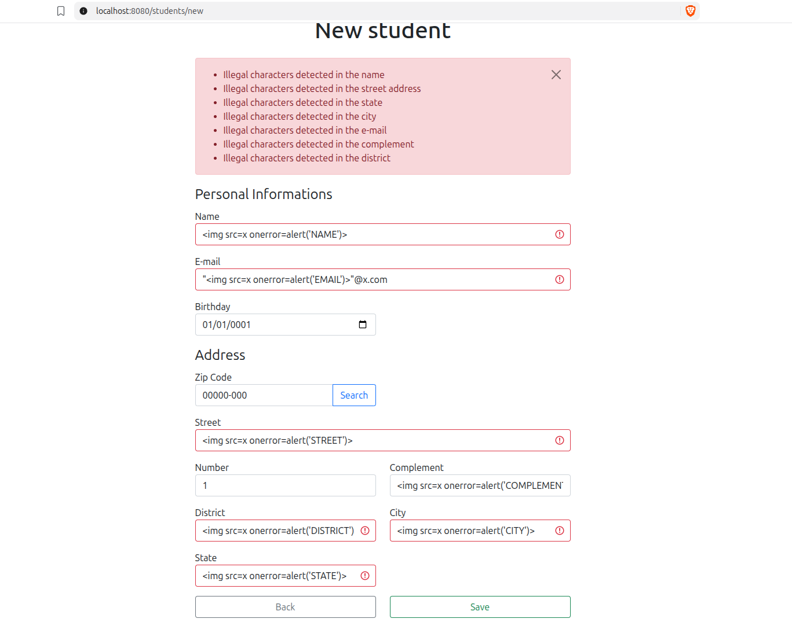

# Zadanie 2 - Raport

**Autor: Paweł Wysocki (325248)**

## Znaleziona podatność XSS

W aplikacji `Java/spring-thymeleaf-crud-example` znaleziono podatność **persistent (stored) XSS** w formularzu rejestracji / aktualizacji danych studenta. Dane wprowadzone przez użytkownika są zapisywane w bazie danych bez odpowiedniej walidacji i sanityzacji, a następnie wyświetlane na stronie listy studentów przy użyciu Thymeleaf z niebezpiecznym atrybutem `th:utext`, który nie wykonuje escapingu HTML.

### Miejsce występowania podatności

Punktem wejścia podatności są formularze rejestracji i edycji studenta (`POST /students/new` i `POST /students/{id}`). Dane w nich wprowadzone są mapowane na obiekty DTO, a następnie zapisywane w bazie danych.

Wykonanie kodu ma miejsce w pliku `src/main/resources/templates/students.html` (linie 33-34 i 37-40), który jest renderowany przy wywołaniu `GET /students`. W tym pliku pola obiektu `StudentResponseDTO` są wyświetlane przy użyciu `th:utext`, co pozwala na wykonanie wstrzykniętego kodu HTML/JavaScript.

Pola `number` i `complement` są zapisywane, ale nie są wyświetlane na liście, więc nie są obecnie podatne.

### Wystąpienie podatności

#### Wprowadzenie szkodliwych danych do formularza


#### Wynik po zapisaniu danych i przejściu do listy studentów

Każda szkodliwa wartość (poza `Complement`, który nie jest wyświetlany na liście) powoduje wywołanie alertu w przeglądarce, co dowodzi wykonania kodu:

- `name` (``):

  

- `email` (`""@x.com`; w tym przypadku cudzysłowy są częścią wartości pola wymagane są dodatkowo cudzysłowy, aby przejść walidację `@Email`):

  

- `street` (``):

  

- `district` (``):

  

- `city` (``):

  

- `state` (``):

  

## Usunięcie podatności XSS

W ramach przeciwdziałania podatności XSS wprowadzono walidację danych wejściowych na poziomie backendu. Ze względu na implementację pola formularza nie mogą zawierać znaków specjalnych HTML (`<`, `>`, `"`, `'`, `&`) ani znaków sterujących. Pozostałe znaki (litery i znaki diakrytryczne, cyfry, spacje, `-`, `,`, `.`, `/` itp.) są dozwolone.

### Implementacja

1. **Adnotacja `@SafeText`** (`validation/SafeText.java`) - autorski Bean Validator, który odrzuca wartości zawierające zabronione znaki. Adnotacja może być stosowana do pól, metod i parametrów.
2. **Walidator `SafeTextValidator`** (`validation/SafeTextValidator.java`) - sprawdza wartość wyrażeniem regularnym `[^<>"'&\p{Cc}]*` - dopuszcza wyłącznie ciągi niezawierające zabronionych znaków. Wartość `null` jest uznawana za poprawną (brak wartości jest kontrolowany przez `@NotNull` i `@NotEmpty`).
3. **Zastosowanie adnotacji** - adnotacja `@SafeText` dodana do pól: `name`, `email`, `zipCode`, `street`, `number`, `complement`, `district`, `city`, `state` w `CreateStudentDTO`.
4. **Komunikat błędu** - klucz `SafeText` w `messages.properties`. Przy niepoprawnych danych formularz jest wyświetlany ponownie z komunikatem, a dane nie trafiają do bazy.

```java
@NotEmpty(message = "{NotEmpty.name}")
@SafeText(message = "{SafeText.name}")
private String name;
```

### Testy

Dodano test jednostkowy `SafeTextValidatorTest`, który sprawdza działanie walidatora w trzech scenariuszach:
- akceptacja poprawnych wartości (`null`, pusty ciąg, tekst z polskimi znakami, adres z przecinkiem i ukośnikiem)
- odrzucenie payloadów XSS (``, `<script>`, cudzysłowy, `&`, znak nowej linii, etc.)
- odrzucenie payloadów we wszystkich sześciu podatnych polach na poziomie `CreateStudentDTO`

### Weryfikacja

Po ponownym zbudowaniu aplikacji wysłanie tych samych payloadów kończy się ponownym wyświetleniem formularza z komunikatem błędu, a na liście `/students` nie pojawia się żaden zapisany kod (brak `onerror`):

  

