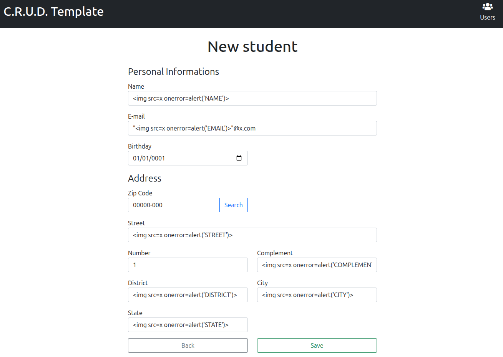
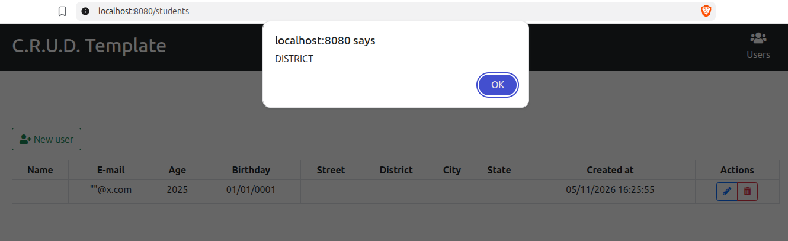
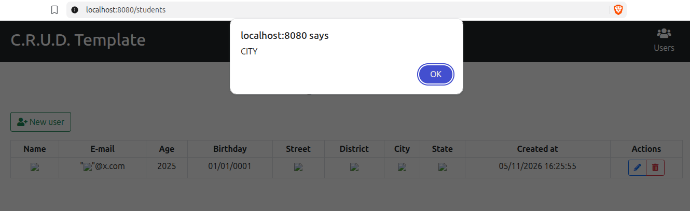
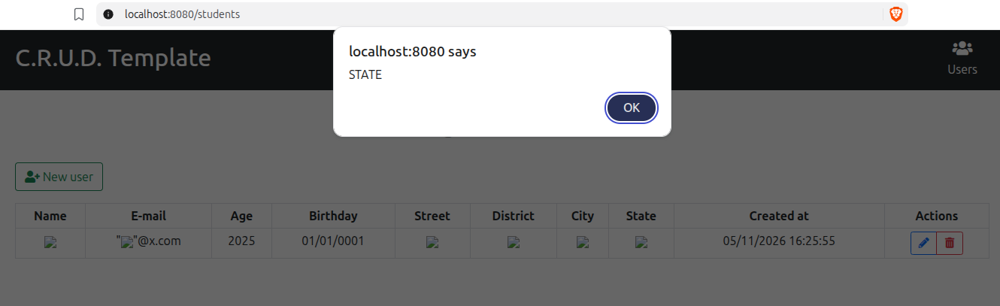

# Zadanie 2 - Raport

**Autor: Paweł Wysocki (325248)**

## Znaleziona podatność XSS

W aplikacji `Java/spring-thymeleaf-crud-example` znaleziono podatność **persistent (stored) XSS** w formularzu rejestracji / aktualizacji danych studenta. Dane wprowadzone przez użytkownika są zapisywane w bazie danych bez odpowiedniej walidacji i sanityzacji, a następnie wyświetlane na stronie listy studentów przy użyciu Thymeleaf z niebezpiecznym atrybutem `th:utext`, który nie wykonuje escapingu HTML.

### Miejsce występowania podatności

Punktem wejścia podatności są formularze rejestracji i edycji studenta (`POST /students/new` i `POST /students/{id}`). Dane w nich wprowadzone są mapowane na obiekty DTO, a następnie zapisywane w bazie danych.

Wykonanie kodu ma miejsce w pliku `src/main/resources/templates/students.html` (linie 33-34 i 37-40), który jest renderowany przy wywołaniu `GET /students`. W tym pliku pola obiektu `StudentResponseDTO` są wyświetlane przy użyciu `th:utext`, co pozwala na wykonanie wstrzykniętego kodu HTML/JavaScript.

Pola `number` i `complement` są zapisywane, ale nie są wyświetlane na liście, więc nie są obecnie podatne.

### Wystąpienie podatności

#### Wprowadzenie szkodliwych danych do formularza

#### Wynik po zapisaniu danych i przejściu do listy studentów

Każda szkodliwa wartość (poza `Complement`, który nie jest wyświetlany na liście) powoduje wywołanie alertu w przeglądarce, co dowodzi wykonania kodu:

- `name` (``):

  

- `email` (`""@x.com`; w tym przypadku cudzysłowy są częścią wartości pola wymagane są dodatkowo cudzysłowy, aby przejść walidację `@Email`):

  

- `street` (``):

  

- `district` (``):

  

- `city` (``):

  

- `state` (``):

  
